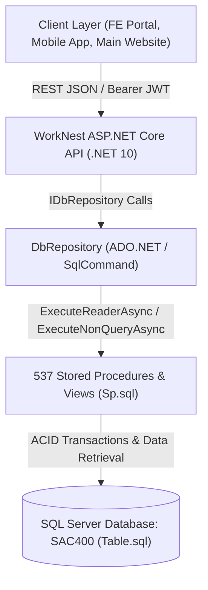
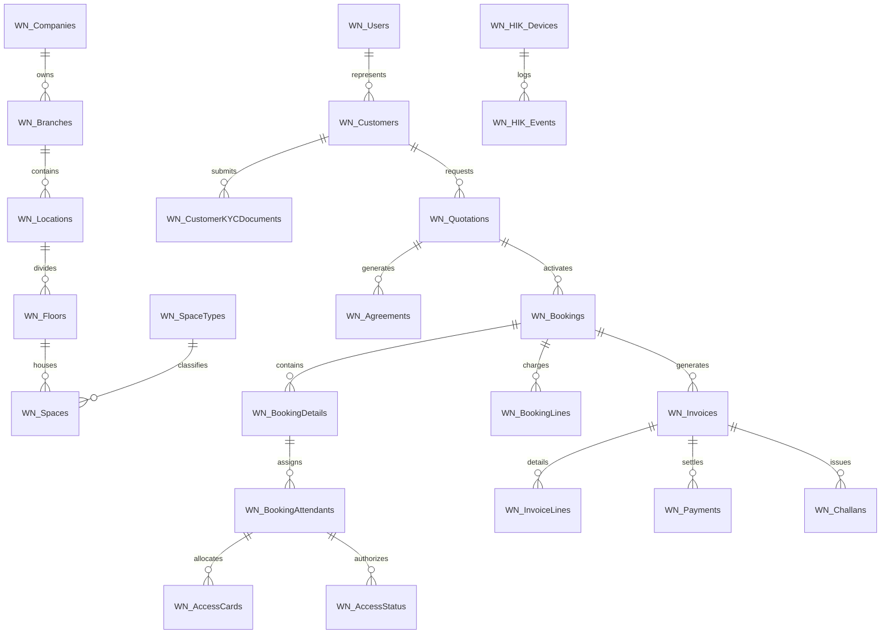
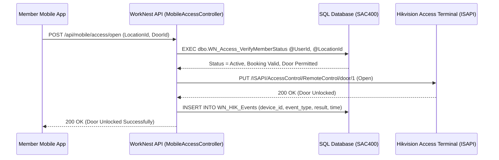
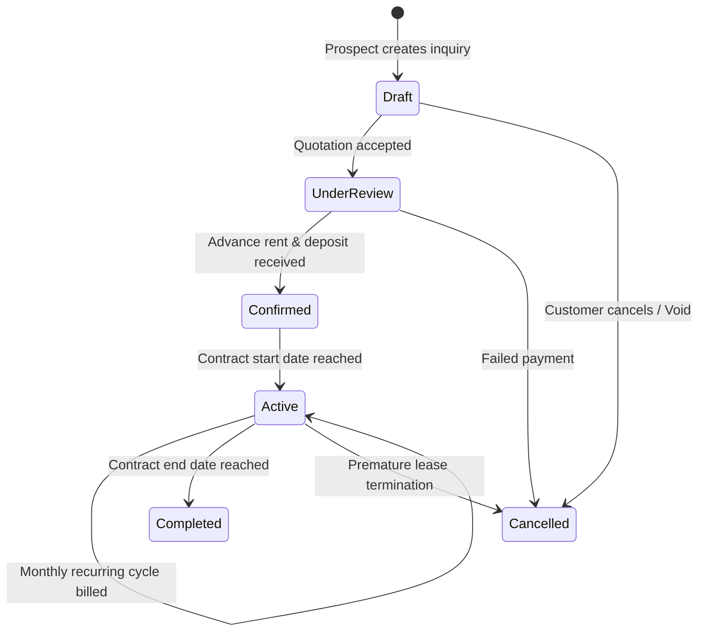

# WorkNest Database Documentation

**Database Name**: `SAC400`  
**Platform**: WorkNest Coworking & Private Offices Management System  
**Architecture Pattern**: Pure Stored Procedure Data Access Layer (`Microsoft.Data.SqlClient` / ADO.NET)  
**Timezone Standard**: Pakistan Standard Time (`Asia/Karachi` / UTC+5)  
**Schema Version**: Script Date April 2026  

---

## Table of Contents
1. [Architecture & Design Principles](#1-architecture--design-principles)
2. [Domain Modules & Entity-Relationship Architecture](#2-domain-modules--entity-relationship-architecture)
3. [Module 1: Location & Physical Space Catalog](#3-module-1-location--physical-space-catalog)
4. [Module 2: User Identity, Customer Profiles & KYC](#4-module-2-user-identity-customer-profiles--kyc)
5. [Module 3: Bookings, Entitlements & Transfers](#5-module-3-bookings-entitlements--transfers)
6. [Module 4: Quotations & Legal Agreements (E-Sign)](#6-module-4-quotations--legal-agreements-e-sign)
7. [Module 5: Invoicing, Payments, Challans & Gateways](#7-module-5-invoicing-payments-challans--gateways)
8. [Module 6: Access Control & Attendance (Hikvision / Mobile Unlock)](#8-module-6-access-control--attendance-hikvision--mobile-unlock)
9. [Module 7: Infrastructure & Network Monitoring (UniFi & GWN)](#9-module-7-infrastructure--network-monitoring-unifi--gwn)
10. [Module 8: Audit Logging, WhatsApp & System Settings](#10-module-8-audit-logging-whatsapp--system-settings)
11. [Core Stored Procedure Catalog](#11-core-stored-procedure-catalog)
12. [Business Rules & State Machine Enums](#12-business-rules--state-machine-enums)

---

## 1. Architecture & Design Principles

### Core Tenets
1. **No Entity Framework / No Migrations**: All transactional operations and reporting logic reside inside SQL Server Stored Procedures (`Sp.sql`).
2. **Public vs. Internal Identifiers**:
   - Internal primary keys are integer identities: `[Id] [int] IDENTITY(1,1) NOT NULL`.
   - Public client-facing tokens are GUIDs: `[IdGUID] [uniqueidentifier]` (or `[PublicId]` in invoices, `[Guid]` in agreements/quotations).
3. **Location Scoping**: Staff (admins, receptionists, sales executives) are strictly restricted by `LocationId`. Queries enforce multi-tenant isolation by location.
4. **Temporal Precision**: All business calendar logic operates under `Asia/Karachi` time. Audit logs store explicit UTC or wall-clock timestamps normalized via `IBusinessClock`.

---

## 2. Domain Modules & Entity-Relationship Architecture

---

## 3. Module 1: Location & Physical Space Catalog

Defines the physical hierarchy of WorkNest: Companies > Branches > Locations > Floors > Spaces.

### `WN_Locations`
Primary physical coworking sites (e.g., F-7, Blue Area, I-9).
* `Id` (`int`, PK): Identity integer.
* `IdGUID` (`uniqueidentifier`): Public reference ID.
* `Name` (`nvarchar(max)`): Location name.
* `BranchId` (`int`, FK): Parent branch reference.
* `CityId` (`int`, FK): Geographic city reference (`WN_Cities`).
* `OpeningTime` / `ClosingTime` (`nvarchar(10)`): Operational hours (e.g., `08:00`, `22:00`).
* `Latitude` / `Longitude` (`decimal(10, 7)`): Geographic coordinates.
* `OneBillBillerCode` / `OneBillPrefix` (`varchar`): 1Link OneBill integration biller configuration.
* `Status` (`int`) / `IsActive` (`bit`): Operational state.

### `WN_Floors`
Building floor division within a location.
* `Id` (`int`, PK): Identity integer.
* `LocationId` (`int`, FK): Parent location.
* `Name` (`nvarchar(100)`): Floor label (e.g., "1st Floor", "Basement").
* `FloorNumber` (`int`): Sort order / architectural level.

### `WN_Spaces`
Inventory units available for reservation (Private Offices, Dedicated Desks, Hot Desks, Meeting Rooms, Event Spaces).
* `Id` (`int`, PK): Identity integer.
* `Code` (`nvarchar(50)`): Human-readable inventory code (e.g., `OFC-102`, `DSK-12`).
* `Name` (`nvarchar(max)`): Room or space name.
* `LocationId` (`int`, FK): Location reference.
* `FloorId` (`int`, FK): Floor reference.
* `SpaceTypeId` (`int`, FK): FK to `WN_SpaceTypes`.
* `Capacity` (`smallint`): Maximum allowed human occupancy.
* `Price` (`decimal(18, 2)`): Base standard rate per billing period.
* `BillingPeriodId` (`tinyint`, FK): Rent frequency (1=Monthly, 2=Daily, 3=Hourly).
* `Status` (`int`) / `IsActive` (`bit`): Inventory status (Available, Occupied, Maintenance).

### `WN_SpaceTypes`
Categorization of spaces: Private Office, Dedicated Desk, Hot Desk, Meeting Room, Virtual Office.

---

## 4. Module 2: User Identity, Customer Profiles & KYC

Manages authenticated users, enterprise customer accounts, attendants, and identity verification.

### `WN_Users`
User identity records powering JWT authentication and role assignment.
* `Id` (`int`, PK): Identity integer.
* `IdGUID` (`uniqueidentifier`): Public user identifier.
* `Name` (`nvarchar(100)`): Full name.
* `Email` (`nvarchar(100)`): Normalized login email.
* `PasswordHash` / `PasswordSalt` (`varbinary(max)`): Cryptographic credentials.
* `RoleId` (`int`, FK): System authorization role (Super Admin=1, Admin=2, Sales Executive=16, Receptionist=17, Customer=General).
* `LocationId` (`int`, FK): Assigned branch boundary for staff.
* `IsActive` (`bit`): Account enablement switch.

### `WN_Customers`
Commercial or individual legal billing entities.
* `Id` (`int`, PK): Identity integer.
* `IdGUID` (`uniqueidentifier`): Public customer token.
* `UserId` (`int`, FK): Linked user account.
* `FirstName` / `LastName` (`nvarchar(100)`): Contact person.
* `Company` (`nvarchar(255)`): Corporate entity title.
* `NTN` (`nvarchar(50)`): National Tax Number (for tax withholding/ST compliance).
* `SecpRegistrationNo` (`nvarchar(50)`): SECP corporate incorporation reference.
* `CnicOrPassport` (`nvarchar(50)`): Government identity identifier.
* `CustomerTypeId` (`int`): Individual (1) vs. Corporate Enterprise (2).
* `AttendanceEnabled` (`bit`): Flag granting team member attendance tracking privileges.

### `WN_CustomerKYCDocuments`
Regulatory compliance verification documents (CNIC front/back, NTN certificate, Form A/29).
* `Id` (`int`, PK): Identity integer.
* `CustomerId` (`int`, FK): Owning customer.
* `DocumentType` (`nvarchar(50)`): Type of document submitted.
* `DocumentPath` (`nvarchar(500)`): Secure storage URI.
* `Status` (`nvarchar(50)`): Verification workflow state (`Pending`, `Verified`, `Rejected`).
* `ReviewedBy` (`int`, FK): Staff member who evaluated the submission.

---

## 5. Module 3: Bookings, Entitlements & Transfers

The central contract and scheduling engine governing space occupancy.

### `WN_Bookings`
The master reservation/contract ledger row.
* `Id` (`int`, PK): Identity integer.
* `IdGUID` (`uniqueidentifier`): Public token used in APIs and URLs.
* `CustomerId` (`int`, FK): Contracting customer.
* `UserId` (`int`, FK): Associated user account.
* `SpaceId` (`int`, FK): Reserved physical inventory unit.
* `BookingStatusId` (`tinyint`): Status state machine:
  * `1` = Active
  * `2` = Confirmed
  * `3` = Cancelled
  * `4` = Completed
  * `5` = Under Review
  * `33` = Active / Recurring
* `StartOn` (`datetime2(7)`): Contract commencement date.
* `EndOn` (`datetime2(7)`): Contract expiry / termination date.
* `MonthlyRent` (`decimal(18, 2)`): Agreed recurring monthly lease rate.
* `SubtotalAmount` (`decimal(18, 2)`): Base contract charge.
* `DiscountPercentage` / `DiscountAmount` (`decimal`): Negotiated concessions.
* `TotalAmount` (`decimal(18, 2)`): Net payable invoice commitment.
* `AdvanceRentMonths` (`int`): Initial prepaid rent duration.
* `SecurityDepositMonths` (`int`): Number of deposit months required.
* `SecurityDepositRequired` (`decimal(18, 2)`): Total security deposit due.
* `SecurityDepositPaid` (`decimal(18, 2)`): Total security deposit realized.
* `BillingPeriodStart` / `BillingPeriodEnd` (`datetime`): Active invoicing cycle interval.
* `NextBillingDate` (`datetime`): Timestamp for next automated billing run.
* `IsDeleted` (`bit`): Soft-delete flag.

### `WN_BookingDetails`
Supplementary contract configuration including taxes, meeting room allowances, and support fees.
* `Id` (`int`, PK): Identity integer.
* `BookingGuid` (`uniqueidentifier`): Relationship link to `WN_Bookings.IdGUID`.
* `AppliedTaxPercentage` (`decimal(5, 2)`): Provincial sales tax rate (e.g., 16.00% PRA/ICT).
* `AppliedChargePercentage` (`decimal(5, 2)`): Administrative support charge rate.
* `MeetingRoomHours` (`decimal(18, 2)`): Monthly complimentary meeting room entitlement hours.

### `WN_BookingAttendants`
Individual employees assigned to a booking who receive building access cards and biometric profiles.
* `Id` (`int`, PK): Identity integer.
* `BookingDetailId` (`int`, FK): Linked booking details record.
* `PersonId` (`int`, FK): Member profile in `WN_Persons`.
* `CustomerId` (`int`, FK): Employer customer record.
* `IsOverCapacity` (`bit`): Flags whether this attendant exceeds the base capacity of the space.
* `SurchargeApplied` (`decimal(18, 2)`): Additional monthly fee charged for over-capacity personnel.
* `AssignedFrom` / `AssignedTo` (`date`): Active authorization date interval.

---

## 6. Module 4: Quotations & Legal Agreements (E-Sign)

Sales pipeline conversion from prospect quotation to digitally signed lease contract.

### `WN_Quotations`
Commercial price quotes issued to prospects.
* `Id` (`int`, PK): Identity integer.
* `Guid` (`uniqueidentifier`): Public quotation identifier.
* `QuotationNumber` (`nvarchar(50)`): Formal sequence reference (e.g., `QT-2026-0042`).
* `CustomerId` (`int`, FK): Recipient client.
* `SpaceId` (`int`, FK): Proposed space.
* `QuotationDate` / `ValidUntil` (`date`): Offer validity timeline.
* `SubtotalAmount` / `DiscountAmount` / `TotalAmount` (`decimal(18, 2)`): Commercial proposal.
* `Status` (`nvarchar(50)`): Workflow state (`Draft`, `Sent`, `Accepted`, `Converted`, `Expired`).
* `Version` (`int`): Incrementing negotiation revision counter.

### `WN_Agreements`
Formal legal lease agreements generated upon accepted quotation.
* `Id` (`int`, PK): Identity integer.
* `Guid` (`uniqueidentifier`): Secure signing token.
* `QuotationId` (`int`, FK): Originating quotation.
* `BookingId` (`int`, FK): Resulting booking upon signature execution.
* `CustomerId` (`int`, FK): Lessee.
* `Status` (`nvarchar(50)`): Lifecycle state (`Draft`, `Sent`, `Signed`, `Terminated`).
* `FeeAmount` (`decimal(18, 2)`): Monthly recurring license fee.
* `SecurityDeposit` (`decimal(18, 2)`): Required refundable collateral.
* `RefundDays` (`int`): Stipulated days for security deposit refund after vacancy inspection.

### `WN_AgreementESignatures`
Audit trail of legal digital signatures.
* `Id` (`int`, PK): Identity integer.
* `AgreementId` (`int`, FK): Associated agreement.
* `SignerName` / `SignerEmail` (`nvarchar`): Authorized signer credentials.
* `SignedAt` (`datetime2(0)`): Cryptographic execution timestamp.
* `IpAddress` / `UserAgent` (`nvarchar`): Originating network metadata.
* `DocumentSha256` (`char(64)`): SHA-256 hash of the counter-signed legal contract.
* `SignatureImage` (`varbinary(max)`): Digitally rendered vector/PNG signature stroke data.

---

## 7. Module 5: Invoicing, Payments, Challans & Gateways

Comprehensive financial ledger handling recurring invoicing, tax invoices, bank challans, and 1Link OneBill.

### `WN_Invoices`
Billing invoice headers.
* `Id` (`int`, PK): Identity integer.
* `PublicId` (`uniqueidentifier`): Public invoice identifier used in customer portal.
* `InvoiceNumber` (`nvarchar(50)`): Invoice number (e.g., `INV-2026-0819`).
* `UserId` (`int`, FK): Payer account.
* `BookingId` (`int`, FK): Associated contract (null for ad-hoc custom invoices).
* `InvoiceTypeId` (`int`):
  * `1` = Advance Rent (Contract initiation)
  * `2` = Recurring Monthly Rent
  * `3` = Security Deposit
  * `4` = Attendant Overcapacity Surcharge
  * `5` = Custom Invoice / Amenities
  * `6` = Sales Tax Invoice
* `StatusId` (`tinyint`):
  * `1` = Unpaid
  * `2` = Paid
  * `3` = Partially Paid
  * `4` = Overdue
  * `5` = Cancelled / Void
* `IssuedOn` / `DueOn` (`date`): Invoicing deadlines.
* `SubTotal` (`decimal(18, 4)`): Base billable charges.
* `DiscountTotal` (`decimal(18, 4)`): Total applied deductions.
* `TaxTotal` (`decimal(18, 4)`): Provincial Sales Tax.
* `GrandTotal` (`decimal(18, 4)`): Net payable invoice balance.
* `PaidTotal` (`decimal(18, 4)`): Total payment receipts applied.
* `OneBillNumber` (`varchar(30)`): 1Link 1Bill 24-digit consumer invoice number.
* `OneBillStatus` (`tinyint`): 1Link synchronization status.
* `ApprovalStatus` (`nvarchar(50)`): Sales executive invoice approval queue (`PendingApproval`, `Approved`).

### `WN_InvoiceLines`
Itemized line-item charges forming an invoice.
* `Id` (`int`, PK): Identity integer.
* `InvoiceId` (`int`, FK): Parent invoice.
* `ChargeTypeId` (`int`, FK): Category (Rent, Security Deposit, Over-capacity Attendant, Electricity, Locker).
* `Description` (`nvarchar(500)`): Human-readable item breakdown.
* `Amount` (`decimal(18, 4)`): Net line amount before tax.
* `TaxRate` / `TaxAmount` (`decimal`): Computed line-item tax.
* `SortOrder` (`smallint`): PDF layout sequence order.

### `WN_Payments`
Payment receipts realized through bank transfers, cash vouchers, or payment gateways.
* `Id` (`int`, PK): Identity integer.
* `IdGUID` (`uniqueidentifier`): Public receipt voucher.
* `InvoiceId` (`int`, FK): Settled invoice.
* `Amount` (`decimal(18, 2)`): Realized monetary value.
* `PaymentMethodId` (`tinyint`):
  * `1` = Cash / Bank Slip
  * `2` = 1Link 1Bill
  * `3` = PayFast Credit/Debit Card
  * `4` = Online Bank Transfer (IBFT)
  * `5` = EzPay Gateway
* `StatusId` (`tinyint`): `1`=Pending, `2`=Cleared/Settled, `3`=Failed, `4`=Reversed.
* `TransactionRef` (`nvarchar(120)`): Bank reference / RRN / Gateway transaction ID.
* `PaidOn` (`datetime2(7)`): Bank confirmation timestamp.

### `WN_Challans`
Printed 3-copy bank deposit challans (Customer Copy, Bank Copy, WorkNest Copy).
* `Id` (`int`, PK): Identity integer.
* `ChallanNumber` (`nvarchar(50)`): Structured challan reference.
* `BookingId` (`int`, FK): Linked booking.
* `IssueDate` / `DueDate` (`datetime`): Bank validity window.
* `Amount` (`decimal(18, 4)`): Authorized deposit amount.
* `Status` (`nvarchar(50)`): `Unpaid`, `Paid`, `Expired`.

---

## 8. Module 6: Access Control & Attendance (Hikvision / Mobile Unlock)

Building perimeter security, automated turnstiles, biometric door controllers, and mobile BLE/remote unlock.

### `WN_AccessCards`
RFID cards, keyfobs, and digital credential identifiers.
* `Id` (`int`, PK): Identity integer.
* `CardNumber` (`nvarchar(100)`): Physical card hexadecimal / Wiegand number.
* `CustomerId` (`int`, FK): Assigned customer account.
* `BookingId` (`int`, FK): Active contract authorization.
* `SpaceId` (`int`, FK): Authorized office/desk suite.
* `StartDate` / `EndDate` (`datetime`): Active access lifespan.
* `Status` (`int`): `1` = Active, `2` = Expired, `3` = Blocked/Revoked.

### `WN_HIK_Devices`
Physical Hikvision biometric terminals, facial recognition panels (MinMoe), and door controllers.
* `Id` (`int`, PK): Identity integer.
* `Device_name` (`nvarchar(100)`): Hardware label (e.g., `F7-Main-Turnstile-In`).
* `Ip_address` (`nvarchar(50)`): Local network IP address.
* `Port` (`int`): ISAPI HTTP/HTTPS port (default 80 / 443).
* `Username` / `Password` (`nvarchar`): Encrypted terminal credentials.
* `LocationId` (`int`, FK): Physical location where the hardware is mounted.
* `Status` (`int`): Hardware online/offline status monitor.

### `WN_HIK_Events`
Raw access telemetry logs pushed from Hikvision devices via webhook/listening services.
* `id` (`bigint`, PK): Auto-incrementing log sequence.
* `device_id` (`int`, FK): Source access controller.
* `event_time` (`datetime2(0)`): Physical badge scan timestamp.
* `card_no` (`nvarchar(50)`): Scanned card serial number.
* `employee_no` (`nvarchar(50)`): Hikvision internal person identifier.
* `name` (`nvarchar(100)`): Resolved individual name.
* `event_type` (`int`): Access granted (1), Access denied (2), Door left open (3).

---

## 9. Module 7: Infrastructure & Network Monitoring (UniFi & GWN)

Enterprise Wi-Fi client telemetry, network bandwidth monitoring, and client access rules.

### UniFi Network (`WN_UNIFI_*`)
Integrates with Ubiquiti UniFi Dream Machines & Controller APIs for location network metrics:
* `WN_UNIFI_Settings`: Controller base URL, API credentials, and site identifier mapping per location.
* `WN_UNIFI_History`: Periodic snapshot logs capturing total Wi-Fi clients, wired clients, guest clients, WAN throughput, and ISP latency.
* `WN_UNIFI_SsidDevices`: MAC-level inventory of authorized customer hardware on private SSIDs.

### Grandstream Network (`WN_GWN_*`)
Integrates with Grandstream GWN Cloud / Manager APIs powering dedicated location Wi-Fi:
* `WN_GWN_NetworkLocations`: Location-to-GWN Network ID bindings.
* `WN_GWN_ClientAliases`: Mapping customer company names to MAC addresses for bandwidth shaping.
* `WN_GWN_ActionLog`: Security audit log recording administrative network actions (blocking rogue MAC addresses, rebooting APs).

---

## 10. Module 8: Audit Logging, WhatsApp & System Settings

### `WN_AuditLog`
Comprehensive database audit trail capturing data mutation.
* `Id` (`int`, PK): Identity integer.
* `EntityName` (`nvarchar(100)`): Mutated table (e.g., `WN_Bookings`, `WN_Payments`).
* `RecordId` (`nvarchar(100)`): Primary key of affected record.
* `Action` (`nvarchar(50)`): Operation (`INSERT`, `UPDATE`, `DELETE`).
* `OldValues` / `NewValues` (`nvarchar(max)`): Serialized JSON delta of row state before and after execution.
* `UserId` (`int`, FK): Originating user who invoked the operation.
* `Timestamp` (`datetime2(7)`): Precise UTC execution time.

### WhatsApp Meta Cloud API (`WN_WhatsApp_*`)
* `WN_WhatsApp_Contacts`: Synced customer phone numbers with Opt-in status.
* `WN_WhatsApp_Messages`: Inbound and outbound customer service chat messages, broadcast campaign receipts, and automated payment reminder templates.

### `WN_BillingSettings`
Key-value configuration table governing recurring automation cycles:
* `SendDeadlineDay`: Monthly cutoff day for invoice delivery (e.g., 18th).
* `ReminderDaysBeforeDeadline`: Window for pending approval alerts (e.g., 3 days).
* `DefaultTaxPercentage`: Standard provincial tax rate fallback.

---

## 11. Core Stored Procedure Catalog

The system includes 537 Stored Procedures and Views. Below are the critical procedures powering core business workflows:

### A. Billing & Invoicing Automation
* **`dbo.WN_Billing_GetDueBookings`**:
  * **Purpose**: Executed hourly by `BillingAutomationService` background worker.
  * **Logic**: Evaluates all active bookings (`BookingStatusId IN (1, 2, 5, 33)`) where `NextBillingDate <= DATEADD(day, 5, GETDATE())` and returns contracts due for recurring monthly invoice generation.
* **`dbo.WN_Invoice_CheckExistingBillingPeriod`**:
  * **Purpose**: Idempotency guard.
  * **Parameters**: `@BookingId`, `@BillingPeriodStart`, `@BillingPeriodEnd`.
  * **Returns**: `1` if an invoice already exists for this exact cycle interval, preventing double-billing.
* **`dbo.WN_Invoice_CreateRecurring`**:
  * **Purpose**: Primary recurring invoice generator.
  * **Logic**: Calculates monthly rent, applies attendant over-capacity surcharges, looks up location tax rates, generates sequential `InvoiceNumber`, creates `WN_InvoiceLines`, and sets status to `Unpaid` (`PendingApproval`).
* **`dbo.WN_Invoices_GetPendingApprovalLocationSummary`**:
  * **Purpose**: Aggregates pending recurring invoices by location for sales team review.

### B. Booking & Availability Engine
* **`dbo.WN_Booking_CreateSmart`**:
  * **Purpose**: Complete transactional booking creation.
  * **Logic**: Validates space availability, locks dates, registers customer record, calculates security deposit, advance rent, generates initial Advance Rent Invoice (`InvoiceTypeId = 1`), and generates deposit challan in a single transaction.
* **`dbo.WN_Space_GetAvailabilityCalendar`**:
  * **Purpose**: Real-time calendar query powering front-end booking grids.
  * **Parameters**: `@LocationId`, `@SpaceTypeId`, `@StartDate`, `@EndDate`.
  * **Logic**: Cross-references `WN_Spaces` against overlapping records in `WN_Bookings` where `IsDeleted = 0` and status is active.

### C. Access Control & Attendants
* **`dbo.WN_Attendant_AssignToBooking`**:
  * **Purpose**: Enrolls a person under a booking.
  * **Logic**: Evaluates whether space capacity is exceeded; if true, sets `IsOverCapacity = 1` and calculates applicable monthly surcharge fee.
* **`dbo.WN_HIK_Sync_GetPendingUsers`**:
  * **Purpose**: Gathers active booking attendants and cards requiring biometric/card push to Hikvision terminals.

---

## 12. Business Rules & State Machine Enums

### Booking State Machine (`BookingStatusId`)

### Invoice Status State Machine (`StatusId`)
| StatusId | Meaning | Accounting Impact | Actions Permitted |
| :---: | :--- | :--- | :--- |
| **1** | **Unpaid** | Accounts Receivable debited, Revenue pending | PayFast, Challan, 1Link, Manual Receipt |
| **2** | **Paid** | Accounts Receivable credited, Cash/Bank debited | Print Official Receipt, Generate Tax Invoice |
| **3** | **Partially Paid** | Partial receipt credited, remaining balance due | Issue partial receipt, secondary payment |
| **4** | **Overdue** | Past `DueOn` date, triggers automated SMS/Email | Automated late reminders, access suspension |
| **5** | **Cancelled / Void** | Invoice invalidated, reverse ledger adjustments | No payments allowed, historical audit only |

### Space Inventory Status (`Status`)
* `1` = **Available**: Vacant and ready for reservation.
* `2` = **Occupied**: Active contract present.
* `3` = **Reserved**: Pending quotation acceptance or signed agreement.
* `4` = **Under Maintenance**: Physical repairs, painting, IT wiring overhaul.

