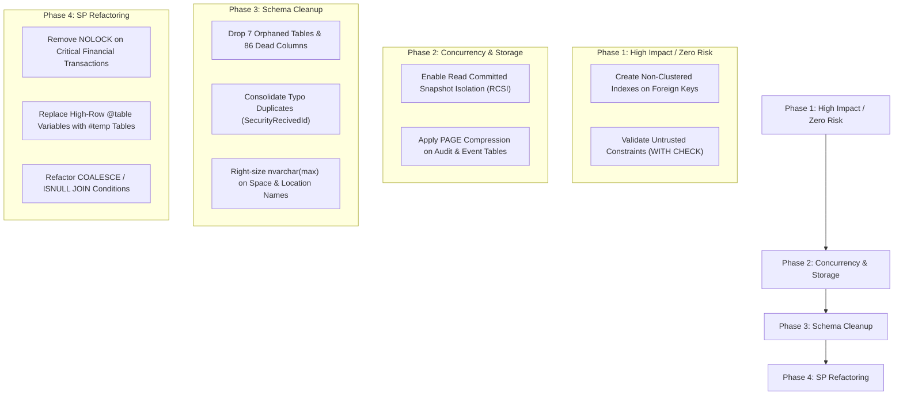

# Database Optimization & Schema Audit Report

**Target Database**: `SAC400`  
**Analyzed Files**: `Table.sql` (137 Tables) & `Sp.sql` (537 Procedures / Views, 28,400+ lines)  
**Date**: November 2026  

---

## Table of Contents
1. [Executive Summary](#1-executive-summary)
2. [Audit: Useless & Dead Columns (0 References)](#2-audit-useless--dead-columns-0-references)
3. [Audit: Duplicate & Conflicting Columns](#3-audit-duplicate--conflicting-columns)
4. [Audit: Orphaned Tables (Doing Nothing)](#4-audit-orphaned-tables-doing-nothing)
5. [Performance Bottleneck #1: Missing Foreign Key & Search Indexes](#5-performance-bottleneck-1-missing-foreign-key--search-indexes)
6. [Performance Bottleneck #2: Concurrency & The 1,652 `NOLOCK` Hints](#6-performance-bottleneck-2-concurrency--the-1652-nolock-hints)
7. [Performance Bottleneck #3: Data Type Bloat & Memory Grants](#7-performance-bottleneck-3-data-type-bloat--memory-grants)
8. [Performance Bottleneck #4: Stored Procedure Anti-Patterns](#8-performance-bottleneck-4-stored-procedure-anti-patterns)
9. [Storage Compression & Maintenance Strategy](#9-storage-compression--maintenance-strategy)
10. [Step-by-Step Implementation Action Plan](#10-step-by-step-implementation-action-plan)

---

## 1. Executive Summary

| Category | Finding | Impact | Action |
| :--- | :--- | :--- | :--- |
| **Dead Columns** | 22+ columns with **0 occurrences** in SQL/C# | Cluttered schemas, misleading DTOs | Drop unused columns |
| **Typo Duplicates** | Duplicate columns with spelling differences in core tables | Bugs, schema confusion, sync drift | Consolidate into canonical column |
| **Copy-Paste Columns** | 5 Chart-of-Account IDs pasted across 8 unrelated tables | Wasted row space, schema bloat | Drop unneeded foreign keys |
| **Dual Status Columns** | 9 tables with both `IsActive` (bit) and `Status` (int) | Ambiguous business logic | Standardize to single status field |
| **Missing Indexes** | **Zero non-clustered indexes** on Foreign Keys in `Table.sql` | Clustered Index Scans on every JOIN/filter | Add targeted non-clustered indexes |
| **Concurrency / Locks** | 1,652 `WITH (NOLOCK)` hints across `Sp.sql` | Dirty reads, missing rows, duplicate reads | Enable RCSI at database level |
| **Data Type Bloat** | 56 `nvarchar(max)` and 49 legacy `datetime` columns | Off-row storage pointers, memory grant bloat | Right-size to `nvarchar(100/500)` and `datetime2` |
| **Untrusted Constraints**| 51 Foreign Keys added `WITH NOCHECK` | Optimizer cannot perform join elimination | Validate constraints (`WITH CHECK`) |

---

## 2. Audit: Useless & Dead Columns (0 References)

These columns are declared in `Table.sql` but have **zero occurrences** in `Sp.sql` and **zero usage** in the C# application code.

### A. Core Transaction Tables
* **`WN_Bookings`**
  * `[LogApiId]` (`uniqueidentifier`): Abandoned API request logging field.
  * `[HubConsumerNo]` (`nvarchar(max)`): Legacy Hub integration field.
  * `[HubActionSatus]` (`int`): Legacy Hub integration status (spelled with typo `Satus`).
  * `[HubActionDate]` (`datetime`): Legacy Hub integration date.
  * `[HubActionPaidAmount]` (`decimal(18, 4)`): Legacy Hub integration amount.
  * `[HubActionById]` (`int`): Legacy Hub integration user ID.
  * `[BatchSyncStatus]` (`int`): Dead batch sync flag.
  * `[BatchSyncDate]` (`datetime`): Dead batch sync timestamp.
  * `[ShiftTypeId]` (`int`): Stored procedures exclusively use `[ShiftType]` (`nvarchar(20)`).
* **`WN_Quotations`**
  * `[InitialAmountPayable]` (`decimal(18, 2)`): Defined in table, never read or written by any quotation procedure.
  * `[RemainingContractRent]` (`decimal(18, 2)`): Never populated or queried.
* **`WN_Spaces`**
  * `[OptimumCapacity]` (`smallint`): All SPs and views calculate availability against `[Capacity]`.
* **`WN_BookingAttendants`**
  * `[CustomInvoiceId]` (`int`): Completely unreferenced foreign key.
* **`WN_Agreements`**
  * `[DocumentUrl]` (`nvarchar(500)`): Never written by SPs; PDF tracking is handled via `DocumentSha256` / `WN_AgreementESignatures`.

### B. Configuration & User Tables
* **`WN_ChargeTypeAccountMapping`**
  * `[WHTReceivableId]` (`int`): Unreferenced chart-of-accounts mapping.
* **`WN_ChargeTypeRate`**
  * `[ChargeMode]` (`nvarchar(20)`): Completely unused.
* **`WN_Countries`**
  * `[IsoCode2]` (`nchar(2)`), `[IsoCode3]` (`nchar(3)`), `[PhoneCode]` (`nvarchar(10)`): Lookup fields never populated or queried.
* **`WN_Users`**
  * `[LockoutEnabled]` (`bit`): Unused Identity leftover.
  * `[LockoutEnd]` (`datetimeoffset(7)`): Unused in SQL procedures.

---

## 3. Audit: Duplicate & Conflicting Columns

### A. Literal Typo Duplicates in the Same Table
Two columns exist side-by-side with identical purposes due to a spelling mistake:
* **`WN_Bookings`**:
  * `[SecurityReceivedId]` (`int` NULL)
  * `[SecurityRecivedId]` (`int` NULL) — *Typo: missing "e"*. Both exist in the same table.
* **`WN_Spaces`**:
  * `[SecurityReceivedId]` (`int` NULL)
  * `[SecurityRecivedId]` (`int` NULL) — *Same typo duplicate*.

### B. Mass Copy-Pasted Accounting Columns
The following set of **5 Chart-of-Account foreign keys** was mass copy-pasted into multiple tables where they are completely unpopulated:
```sql
[AccountReceivableId], [RentAccountId], [ServicesIncomeId], [SalesTaxId], [SecurityReceivedId]
```
* **Duplicated and Doing Nothing in:**
  * `WN_Spaces`
  * `WN_SpaceTypes`
  * `WN_SpaceOfferings`
  * `WN_BookingAttendants`
  * `WN_CustomerSTInvoice`
  * `WN_QuotationDetails`
  * `WN_Refunds`
  * `WN_SecurityDepositHoldRelease`

### C. Dual Representation: String vs. Foreign Key ID
These tables store both raw text and the relational Foreign Key ID:
* **`WN_Locations`**: `[City]` (`nvarchar(100)`) vs `[CityId]` (`int`) — redundant with `WN_Cities`.
* **`WN_HIK_Devices`**: `[Location]` (`nvarchar`) vs `[LocationId]` (`int`) — redundant with `WN_Locations`.
* **`WN_Bookings`**: `[ShiftType]` (`nvarchar(20)`) vs `[ShiftTypeId]` (`int`).

### D. Redundant Dual Status Flags (`IsActive` vs `Status`)
Multiple tables store two separate columns tracking whether an entity is active/deleted:
* `WN_Amenities`: `[IsActive]` (`bit`) AND `[Status]` (`int`)
* `WN_Spaces`: `[IsActive]` (`bit`) AND `[Status]` (`int`)
* `WN_SpaceTypes`: `[IsActive]` (`bit`) AND `[Status]` (`int`)
* `WN_Locations`: `[IsActive]` (`bit`) AND `[Status]` (`int`)
* `WN_CustomerKYCDocuments`: `[IsActive]` (`bit`) AND `[Status]` (`int`)
* `WN_Floors`: `[IsActive]` (`bit`) AND `[Status]` (`int`)
* `WN_GalleryImages`: `[IsActive]` (`bit`) AND `[Status]` (`int`)
* `WN_Quotations`: `[IsActive]` (`bit`) AND `[Status]` (`nvarchar(50)`)
* `WN_Users`: `[IsActive]` (`bit`) AND `[Status]` (`int`)
* `WN_Bookings`: Triplicate status tracking: `[BookingStatusId]` (`tinyint`), `[IsDeleted]` (`bit`), and `[BatchSyncStatus]` (`int`).

### E. Multiple GUID Identifiers within the Same Table
* **`WN_BookingDetails`**: `[IdGUID]` (`uniqueidentifier`) AND `[BookingGuid]` (`uniqueidentifier`) — redundant GUIDs for the same row.
* **Inconsistent Schema-wide GUID Naming**:
  * `IdGUID` in `WN_Bookings`, `WN_Spaces`, `WN_Customers`, `WN_AccessCards`
  * `Guid` in `WN_Agreements`, `WN_Quotations`
  * `PublicId` in `WN_Invoices`

### F. Denormalized Customer Data (Already Foreign-Keyed via `CustomerId`)
* **`WN_Agreements`**:
  Already has `[CustomerId] [int]`, yet duplicates:
  * `[CustomerName]`, `[CustomerCnic]`, `[CustomerPhone]`, `[CustomerAddress]`, `[CompanyName]`, `[Ntn]`, `[SecpRegistrationNo]`
* **`WN_Bookings`**:
  Already has `[CustomerId]` and `[UserId]`, yet duplicates `[CustomerCode]`.
* **`WN_Invoices`**:
  Already points to `[BookingId]` and `[UserId]`, yet duplicates `[CustomerCode]`, `[BillingPeriodStart]`, `[BillingPeriodEnd]`, `[BillingPeriodMonths]`, `[AdvanceRentMonths]`, `[SecurityDepositMonths]`.

### G. Redundant Calculated Columns
In **`WN_Quotations`** & **`WN_Bookings`**, both percentage rates and calculated total amounts are stored simultaneously:
* `[DiscountPercentage]` AND `[DiscountAmount]`
* `[AppliedTaxPercentage]` AND `[TaxAmount]`
* `[AppliedChargePercentage]` AND `[SupportChargeAmount]`
* `[SecurityDepositMonths]` AND `[SecurityDeposit]`

---

## 4. Audit: Orphaned Tables (Doing Nothing)

These 7 tables are declared in `Table.sql`, but are **completely absent** from `Sp.sql` and the backend C# code (representing 86 dead columns):

| Table Name | Total Columns | Type / Purpose | Recommendation |
| :--- | :--- | :--- | :--- |
| **`WN_BankReceipts`** | 18 | Abandoned bank receipting feature | Drop table |
| **`WN_BankReceiptsDetails`** | 16 | Child table of `WN_BankReceipts` | Drop table |
| **`WN_ContactFeedbackMoved`** | 4 | Old migration / archive table | Drop table |
| **`WN_ContactsFromBookTour`** | 3 | Old staging table | Drop table |
| **`WN_EmailOtps_Temp`** | 8 | Temporary table left in script | Drop table |
| **`WN_PricingRules`** | 23 | Unimplemented pricing rule engine | Drop table |
| **`WN_ProvincesTemp`** | 4 | Temporary table left in script | Drop table |

---

## 5. Performance Bottleneck #1: Missing Foreign Key & Search Indexes

### The Problem
SQL Server **does not automatically index foreign keys**. In `Table.sql`, the only indexes defined are Clustered Primary Keys (`PK_...`) and Unique Constraints on `IdGUID`.
* Every join between `WN_Invoices` and `WN_Bookings`, `WN_InvoiceLines` and `WN_Invoices`, or `WN_AccessCards` and `WN_Customers` forces a **Clustered Index Scan** across entire tables.
* Recurring billing loops (such as `BillingAutomationService` checking `WN_Invoice_CheckExistingBillingPeriod`) scan the entire `WN_Invoices` table for each booking.

### Critical Indexes to Add Immediately

```sql
-- 1. Invoices & Billing Engine
CREATE NONCLUSTERED INDEX [IX_WN_Invoices_BookingId_Period] 
ON [dbo].[WN_Invoices] ([BookingId], [BillingPeriodStart], [BillingPeriodEnd])
INCLUDE ([StatusId], [GrandTotal], [PaidTotal], [InvoiceTypeId], [IsCustom]);

CREATE NONCLUSTERED INDEX [IX_WN_Invoices_UserId_Status] 
ON [dbo].[WN_Invoices] ([UserId], [StatusId])
INCLUDE ([GrandTotal], [PaidTotal], [DueOn]);

CREATE NONCLUSTERED INDEX [IX_WN_InvoiceLines_InvoiceId] 
ON [dbo].[WN_InvoiceLines] ([InvoiceId])
INCLUDE ([Amount], [SortOrder], [ChargeTypeId]);

-- 2. Bookings & Availability Engine
CREATE NONCLUSTERED INDEX [IX_WN_Bookings_CustomerId_Status] 
ON [dbo].[WN_Bookings] ([CustomerId], [BookingStatusId])
INCLUDE ([StartOn], [EndOn], [SpaceId], [MonthlyRent], [TotalAmount]);

CREATE NONCLUSTERED INDEX [IX_WN_Bookings_SpaceId_Dates] 
ON [dbo].[WN_Bookings] ([SpaceId], [StartOn], [EndOn])
INCLUDE ([BookingStatusId], [IsDeleted]);

-- 3. Payments Engine
CREATE NONCLUSTERED INDEX [IX_WN_Payments_InvoiceId_Status] 
ON [dbo].[WN_Payments] ([InvoiceId], [StatusId])
INCLUDE ([Amount], [PaidOn], [PaymentMethodId]);

-- 4. Access Cards & Attendants
CREATE NONCLUSTERED INDEX [IX_WN_AccessCards_CustomerId_Status] 
ON [dbo].[WN_AccessCards] ([CustomerId], [Status])
INCLUDE ([CardNumber], [BookingId], [SpaceId]);

CREATE NONCLUSTERED INDEX [IX_WN_BookingAttendants_Detail_Capacity] 
ON [dbo].[WN_BookingAttendants] ([BookingDetailId], [IsOverCapacity])
INCLUDE ([AssignedFrom], [AssignedTo], [SurchargeApplied]);

-- 5. Hardware & Event Logs
CREATE NONCLUSTERED INDEX [IX_WN_HIK_Events_Device_Time] 
ON [dbo].[WN_HIK_Events] ([device_id], [event_time])
INCLUDE ([card_no], [employee_no]);
```

### High-Efficiency Filtered Indexes
```sql
-- Active Bookings Only (reduces index volume by up to 90%)
CREATE NONCLUSTERED INDEX [F_IX_WN_Bookings_Active] 
ON [dbo].[WN_Bookings] ([SpaceId], [StartOn], [EndOn])
WHERE [IsDeleted] = 0 AND [BookingStatusId] IN (1, 2, 5, 33);

-- Unpaid Invoices Only (fast queue filtering)
CREATE NONCLUSTERED INDEX [F_IX_WN_Invoices_Unpaid] 
ON [dbo].[WN_Invoices] ([UserId], [DueOn])
WHERE [StatusId] NOT IN (2, 5); -- Excluding Paid/Void
```

---

## 6. Performance Bottleneck #2: Concurrency & The 1,652 `NOLOCK` Hints

### The Problem
* There are **1,652 `WITH (NOLOCK)` table hints** throughout `Sp.sql`.
* `WITH (NOLOCK)` permits dirty reads (uncommitted changes), reads duplicate rows during index page splits, and can skip rows entirely.
* In automated billing (`BillingAutomationService`), running ledger checks under `NOLOCK` can read half-committed invoices or inaccurate attendant surcharges.

### Solution: Enable Read Committed Snapshot Isolation (RCSI)
Eliminate blocking between readers and writers at the database engine level without data corruption:

```sql
-- Run during a short maintenance window (no active connections)
ALTER DATABASE [SAC400] SET READ_COMMITTED_SNAPSHOT ON WITH ROLLBACK IMMEDIATE;
ALTER DATABASE [SAC400] SET ALLOW_SNAPSHOT_ISOLATION ON;
```

* **How it Works**: `SELECT` queries read committed row versions from `tempdb` without taking Shared (`S`) locks.
* **Result**: Writers do not block readers, readers do not block writers, and `WITH (NOLOCK)` hints can be safely removed.

---

## 7. Performance Bottleneck #3: Data Type Bloat & Memory Grants

### The Problem
* **56 `nvarchar(max)` Columns**: Columns such as `Name`, `Description`, `ImageUrl`, `Amenities` on `WN_Spaces` and `Name`, `Address` on `WN_Locations` use `nvarchar(max)`.
  * `nvarchar(max)` cannot be used as an index key column.
  * Causes SQL Server to allocate LOB off-row storage pointers and over-allocate sort memory grants (often reserving megabytes per query instead of kilobytes).
* **49 Legacy `[datetime]` Columns**: `datetime` consumes 8 bytes and has 3.33ms rounding issues.
* **51 Untrusted Foreign Keys**: 51 foreign keys in `Table.sql` were added `WITH NOCHECK`, which prevents the optimizer from doing foreign key elimination.

### Optimization Actions

| Target Table | Target Column | Current Type | Optimized Type | Rationale |
| :--- | :--- | :--- | :--- | :--- |
| `WN_Spaces` | `[Name]` | `nvarchar(max)` | `nvarchar(150)` | Enables indexing, fixes memory grants |
| `WN_Spaces` | `[ImageUrl]` | `nvarchar(max)` | `nvarchar(500)` | URL length fits safely in 500 chars |
| `WN_Spaces` | `[Amenities]` | `nvarchar(max)` | `nvarchar(1000)` | Typical JSON/CSV tags fit within 1KB |
| `WN_Locations` | `[Name]` | `nvarchar(max)` | `nvarchar(150)` | Fixes sorting & index capability |
| `WN_Bookings` | `[StartOn]`, `[EndOn]` | `datetime` | `datetime2(0)` | Saves 25% space, eliminates rounding |
| `WN_Invoices` | `[IssuedOn]`, `[DueOn]`| `date` / `datetime` | `date` | Only calendar date required (saves 5 bytes/row) |
| Multi-tables | Status & Flag fields | `int` (4 bytes) | `tinyint` (1 byte) | Reduces storage by 75% for status columns |

### Validate Untrusted Constraints
Re-validate foreign keys so the SQL Server optimizer can trust them:
```sql
ALTER TABLE [dbo].[WN_Bookings] WITH CHECK CHECK CONSTRAINT ALL;
ALTER TABLE [dbo].[WN_Invoices] WITH CHECK CHECK CONSTRAINT ALL;
ALTER TABLE [dbo].[WN_InvoiceLines] WITH CHECK CHECK CONSTRAINT ALL;
ALTER TABLE [dbo].[WN_Payments] WITH CHECK CHECK CONSTRAINT ALL;
ALTER TABLE [dbo].[WN_Customers] WITH CHECK CHECK CONSTRAINT ALL;
```

---

## 8. Performance Bottleneck #4: Stored Procedure Anti-Patterns

### A. Non-Sargable Joins (29 instances of `JOIN ... ON COALESCE / ISNULL`)
Evaluating functions inside the `ON` clause destroys B-Tree index seek operations and forces full scans:
```sql
-- Anti-Pattern in Sp.sql:
LEFT JOIN dbo.Company comp ON comp.Id = COALESCE(loc.CompanyId, br.CompanyId)
LEFT JOIN dbo.WN_Users u ON u.Id = ISNULL(b.UserId, i.UserId)
LEFT JOIN dbo.WN_Bookings b ON b.Id = COALESCE(p.BookingIdInt, i.BookingId)

-- Optimized Pattern:
LEFT JOIN dbo.WN_Users ub ON ub.Id = b.UserId
LEFT JOIN dbo.WN_Users ui ON ui.Id = i.UserId
-- Use COALESCE(ub.Name, ui.Name) in the SELECT list, not in the JOIN ON condition!
```

### B. 158 `@table` Variables vs `#temp` Tables
SQL Server estimates `@table` variables at a cardinality of **1 row**. When an SP inserts dozens or hundreds of records into `@table` and then joins them against core tables, the optimizer chooses suboptimal nested loops.
* **Rule**: For intermediate datasets with > 50 rows (especially billing line generators and report builders), use `CREATE TABLE #temp` with explicit index creation.

### C. Refactor Subquery OR condition in `WN_Invoice_CreateRecurring`
Line 17733 in `Sp.sql`:
```sql
-- Current:
WHERE (bd.BookingGuid = @BookingGuid OR bd.CustomerCode IN (SELECT Code FROM dbo.WN_Customers WHERE UserId = @UserId))

-- Optimized:
WHERE bd.BookingGuid = @BookingGuid
UNION ALL
SELECT ... FROM ...
WHERE bd.CustomerCode = @CustomerCode AND bd.BookingGuid <> @BookingGuid
```

---

## 9. Storage Compression & Maintenance Strategy

### A. Page Compression on Historical Tables
Enable `PAGE` compression on write-infrequent historical tables:
```sql
ALTER TABLE [dbo].[WN_AuditLog] REBUILD PARTITION = ALL WITH (DATA_COMPRESSION = PAGE);
ALTER TABLE [dbo].[WN_HIK_Events] REBUILD PARTITION = ALL WITH (DATA_COMPRESSION = PAGE);
ALTER TABLE [dbo].[WN_UNIFI_History] REBUILD PARTITION = ALL WITH (DATA_COMPRESSION = PAGE);
ALTER TABLE [dbo].[WN_ChallanAuditLog] REBUILD PARTITION = ALL WITH (DATA_COMPRESSION = PAGE);
```
* **Impact**: Decreases disk footprint by 50–70% and increases effective RAM buffer pool capacity.

### B. Daily Statistics Maintenance
High-churn tables (`WN_Bookings`, `WN_Invoices`, `WN_Payments`) suffer from stale statistics between bulk imports and nightly batch jobs. Configure automated maintenance:
```sql
UPDATE STATISTICS [dbo].[WN_Invoices] WITH FULLSCAN;
UPDATE STATISTICS [dbo].[WN_Bookings] WITH FULLSCAN;
```

---

## 10. Step-by-Step Implementation Action Plan



